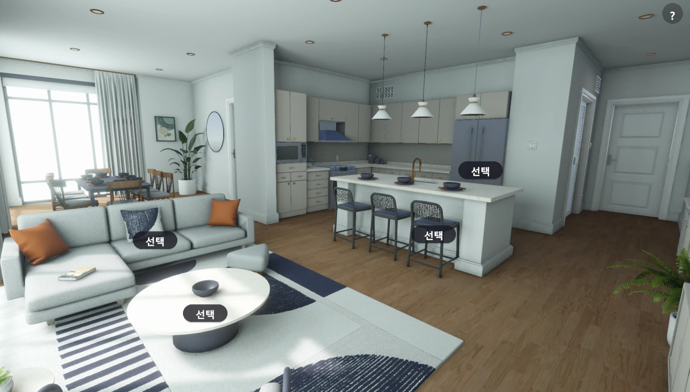
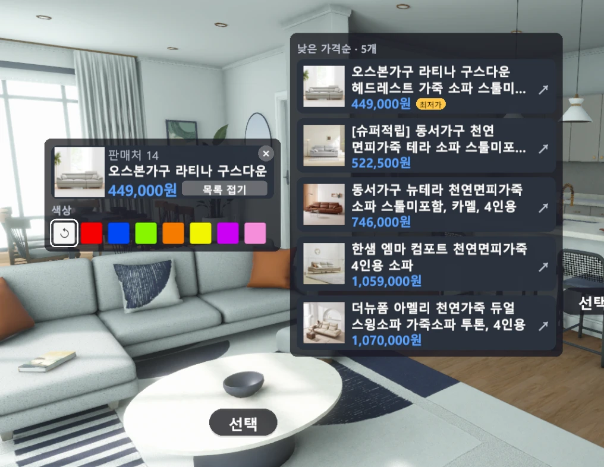
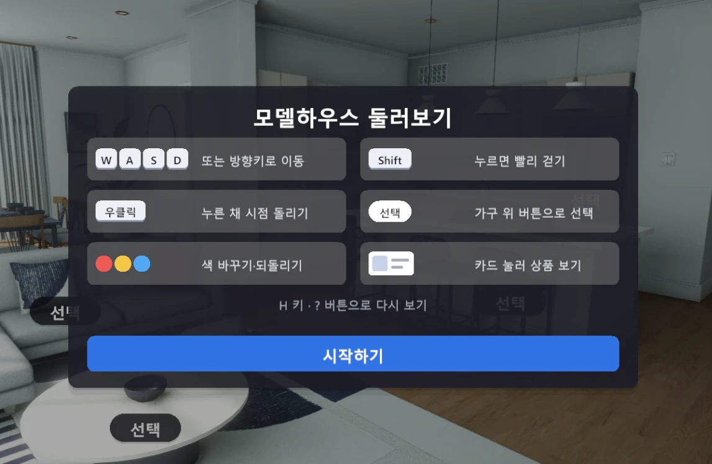

# Room Pick

3D 모델하우스 안을 걸어 다니며 가구를 고르면 **최저가와 상품 목록**을 보여주고, **색상을 바꿔 공간에서 바로 확인**하는 컨피규레이터입니다.

> AURIX 8팀 · 최종 발표 2026-10-14 · Unity 6 (URP)

<p align="center">
  
</p>

## 소개

가구 쇼핑몰은 가격과 색상은 보여주지만 우리 집 공간에서 어울리는지는 알 수 없고, 온라인 3D 모델하우스 투어는 공간은 보여주지만 가격 확인과 색상 변경이 없습니다.
Room Pick은 이 둘을 한 화면에서 합쳤습니다.

1. 3D 모델하우스를 1인칭으로 걸어 다닌다.
2. 가구 위의 **선택** 버튼을 누르면 상품 팝오버가 열린다.
3. 팝오버에서 **최저가 상품**을 확인하고, **다른 상품 목록**을 가격순으로 비교한다.
4. **색상 버튼**으로 가구 색을 바꿔 보고, 되돌리기로 원래 색으로 돌아온다.

## 주요 기능

| 기능 | 설명 |
|---|---|
| 모델하우스 씬 | 구매한 아파트 에셋 1개로 구성한 3D 씬 (`ModernApartment`) |
| 1인칭 이동 | WASD·방향키 이동, 우클릭 드래그 시점 회전, 벽 충돌·이동 범위 제한 |
| 선택 버튼 | 상품 정보가 연결된 가구마다 표시 |
| 최저가 팝오버 | 가구에 연결된 검색 조건으로 네이버 쇼핑을 검색해 필터를 거친 최저가 상품을 표시 |
| 상품 목록 | 가격 오름차순 목록, 첫 행에 최저가 표시, 행을 누르면 판매 페이지가 열림 |
| 색상 변경 | 가구 색만 바뀌고 다른 가구는 그대로, 되돌리기 지원 |
| 안내창 | 실행 시 조작법 안내 (H 키·[?] 버튼으로 다시 열기) |
| 자동문 | 가까이 가면 열리고 멀어지면 닫히는 문 |

<p align="center">
  
  
</p>

## 조작법

| 입력 | 동작 |
|---|---|
| `W` `A` `S` `D` / 방향키 | 이동 |
| `Shift` | 빠르게 걷기 |
| 마우스 우클릭 + 드래그 | 시점 회전 |
| **선택** 버튼 클릭 | 상품 팝오버 열기 |
| 색상 버튼 / ↺ | 색상 변경 / 원래 색으로 되돌리기 |
| 상품 목록 열기 버튼 | 가격순 상품 목록 펼치기·접기 |
| 목록의 상품 클릭 | 판매 페이지 열기 |
| 빈 곳 클릭 / ✕ | 팝오버 닫기 |
| `H` / `Esc` / `Enter` | 안내창 열기·닫기 / 닫기 / 시작 |

## 기술 스택

- **Unity 6000.6.0f1**, Universal Render Pipeline 17.6
- Input System 1.20, uGUI 2.6, TextMesh Pro
- 상품 검색: [SerpApi](https://serpapi.com) 네이버 쇼핑 검색 (`UnityWebRequest`)
- 협업: GitHub, Git LFS, git hooks

## 시작하기

### 1. 준비물

- Unity Hub와 **Unity 6000.6.0f1** (팀 전원 같은 버전을 씁니다)
- Git, [Git LFS](https://git-lfs.com)
- [SerpApi](https://serpapi.com) API 키 (상품 검색에 사용)

### 2. 내려받기

```bash
git clone <저장소 주소>
cd Room_Pick
git lfs install
git config core.hooksPath .githooks   # 커밋 규칙 자동 검사
git checkout develop
```

### 3. API 키 설정

프로젝트 루트(`Assets`와 같은 위치)에 `.env` 파일을 만들고 키를 적습니다. `.env`는 `.gitignore`에 들어 있어 **git에 올라가지 않습니다.**

```dotenv
SERPAPI_API_KEY=발급받은_키
# SERPAPI_ENGINE=naver   # 선택 (기본값: naver)
```

키가 없으면 Console에 `.env에 SERPAPI_API_KEY 값이 없습니다` 오류가 기록되고 상품 정보를 불러오지 못합니다.

> **키를 저장소나 메신저에 공유하지 마세요.**

### 4. 실행

1. Unity Hub에서 이 폴더를 프로젝트로 엽니다.
2. `Assets/Scenes/ModernApartment.unity`를 엽니다.
3. Play를 누릅니다.

### 빌드로 실행할 때

`.env`는 빌드에 포함되지 않습니다. 코드는 `Application.dataPath`의 상위 폴더에서 `.env`를 읽으므로, Windows 빌드에서는 **실행 파일과 같은 폴더에 `.env`를 직접 두어야** 상품 정보가 나옵니다. (코드 기준이며, 사용하는 빌드에서 직접 확인하세요.)

## 프로젝트 구조

```
Assets/
├─ Scenes/            ModernApartment (메인), SampleScene
├─ Scripts/
│  ├─ Core/           Product, WebUrl 등 공통 모델과 링크 열기
│  ├─ Exceptions/     ErrorCode, RoomPickException
│  ├─ Search/         SearchKeyword, ProductFilter (가구별 검색·필터 기준)
│  ├─ ProductSource/  SerpApi 설정(.env), 응답 모델, 썸네일 로더
│  ├─ Repository/     IProductRepository, SerpApiProductRepository
│  ├─ Service/        IProductSearch, ProductService (필터 → 가격순 정렬 → 최저가)
│  ├─ UI/             팝오버·목록·안내창 등 화면과 스타일
│  ├─ World/          CameraController, ColorChanger, ProductTarget, AutoDoor
│  ├─ Input/          ObjectPicker (클릭 판정)
│  └─ Editor/         씬 구성 보조 메뉴 (RoomPick 메뉴)
└─ Zeps3D/            모델하우스 에셋 (외부 구매)
docs/                 SRS, WBS, 클래스 다이어그램, 브랜치 전략 가이드
```

## 동작 구조

```
UI (ProductInfoController, ProductPopover, ProductListView)
 └─ Service  ProductService          필터 → 가격 오름차순 정렬 → 최저가
     └─ Repository  SerpApiProductRepository (IProductRepository)
         └─ SerpApi · 네이버 쇼핑 검색
```

- 계층 사이를 인터페이스(`IProductSearch`, `IProductRepository`)로 분리해 외부 API가 바뀌어도 Service와 UI는 그대로 쓸 수 있습니다.
- 가구(`ProductTarget`)마다 검색어와 **필터 기준**(최소 가격, 필수 단어, 제외 단어)을 인스펙터에서 지정합니다. 검색 결과에 부품·소품·0원 상품이 섞여도 필터를 거친 뒤에 최저가를 고르므로 최저가로 추천되지 않습니다.
- 같은 가구를 다시 선택하면 검색 결과 캐시를 사용해 API를 다시 호출하지 않습니다.
- 색상은 인스턴스 머티리얼의 `_BaseColor`를 바꾸므로 원본 에셋은 수정되지 않습니다.

## 문서

| 문서 | 위치 |
|---|---|
| 소프트웨어 요구사항 명세서 (SRS) | [`docs/SRS_RoomPick_AURIX.docx`](docs/SRS_RoomPick_AURIX.docx) |
| 작업 분할 구조도 (WBS) | [`docs/RoomPick_AURIX_WBS.xlsx`](docs/RoomPick_AURIX_WBS.xlsx) |
| 클래스 다이어그램 v5 | [`docs/RoomPick_클래스다이어그램_v5.svg`](docs/RoomPick_클래스다이어그램_v5.svg) |
| 유니티 프로젝트 Git 브랜치 전략 가이드 | [`docs/유니티프로젝트_Git브랜치전략가이드.pdf`](docs/유니티프로젝트_Git브랜치전략가이드.pdf) |
| 협업 컨벤션 | [`CONVENTION.md`](CONVENTION.md) |
| 커밋 메시지 규칙 | [`COMMIT_RULES.md`](COMMIT_RULES.md) |

> SRS는 상품 데이터를 앱에 내장하고 네트워크를 쓰지 않는 것으로 정의했지만, 구현 단계에서 실시간 가격을 보여주기 위해 SerpApi 검색으로 바꿨습니다. 이 점은 SRS와 다릅니다.

## 협업 규칙

- 브랜치: `main`(배포본) ← `develop`(통합) ← `feature/<이름>-<기능>`
- `main`과 `develop`에는 직접 커밋하지 않고 PR로만 합칩니다.
- 커밋 메시지: `<타입>: <제목>` (예: `feat: 안내창 디자인 개선`)

자세한 내용은 [`CONVENTION.md`](CONVENTION.md), [`COMMIT_RULES.md`](COMMIT_RULES.md)를 참고하세요.

## 알려진 제한과 향후 계획

- 상품 정보는 SerpApi 응답을 기다리므로 첫 선택 때 약 2.5~2.9초가 걸립니다. (같은 가구를 다시 선택하면 캐시로 즉시 표시)
- 네트워크나 API 키가 없으면 상품 정보를 보여주지 못합니다.
- 자동화 테스트와 CI가 없습니다.
- 계획: 장바구니와 총 예산 계산, 가구 배치 편집과 구성 저장, 서버 프록시로 API 키 보호, EditMode 테스트와 CI

## 팀

**AURIX 8팀**: 도희정(팀장), 최치언

## 라이선스와 에셋

- 모델하우스 에셋(`Assets/Zeps3D`)은 외부에서 구매한 상용 에셋입니다. **판매처의 라이선스 범위 안에서만** 사용하며 재배포할 수 없습니다. 저장소를 공개하기 전에 에셋을 제외하거나 라이선스를 확인하세요.
- 이 저장소의 코드에는 별도 라이선스를 지정하지 않았습니다.
